# Démonstration : un restaurant fictif en une commande

**Avant** : SenYummies, la marque par défaut, sans aucune configuration (données de démonstration du profil dev).
**Après** : Kër Saveurs, le restaurant fictif de `clients/exemple/`, généré avec :

```sh
npm run client -- exemple
cd deploiements/exemple
docker compose --env-file .env --env-file .env.secrets -f docker-compose.yml -f docker-compose.local.yml up -d
```

Les **mêmes images Docker** servent les deux versions : seuls `.env`, `marque/` et `donnees/` changent. Au premier démarrage, le backend a importé 41 fiches : 5 catégories, 13 produits, 6 accompagnements et condiments, 3 plats du jour, 1 annonce, la région Thiès et ses 5 zones, les 2 services et 5 comptes. Au redémarrage suivant, il a journalisé « passage … déjà appliqué, rien à faire ».

Captures du 19 novembre 2026 : Client en 390 px de large (mobile), Manager en 1440 px.

## App Client

| | Avant (SenYummies) | Après (Kër Saveurs) |
|---|---|---|
| Écran de démarrage : logo, nom en deux tons, slogan, photo de fond | 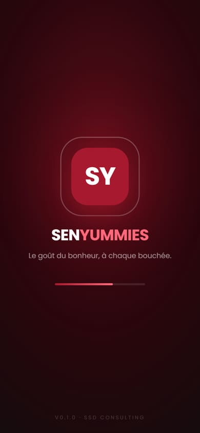 | 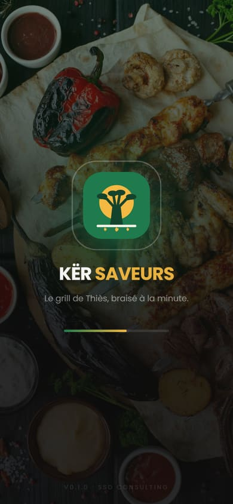 |
| Accueil : en-tête, bannière, pastille, slogan, couleur | 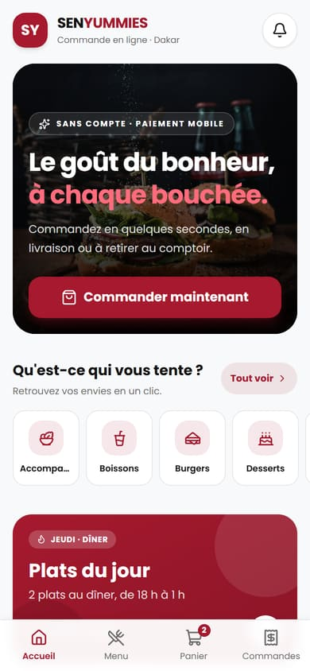 | 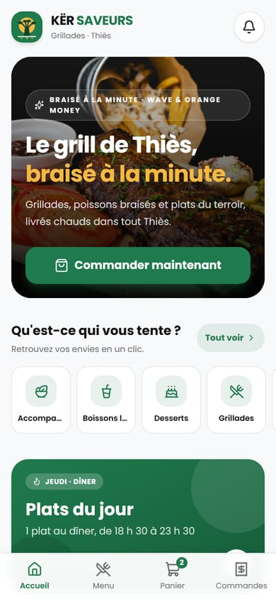 |
| Menu : catalogue importé, horaires des services du restaurant | 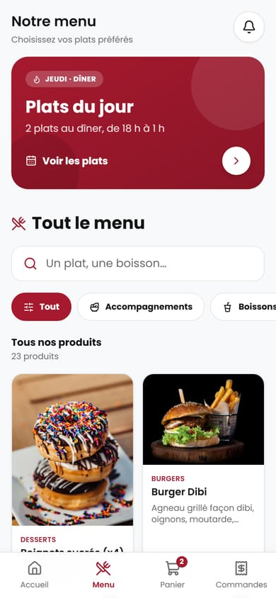 | 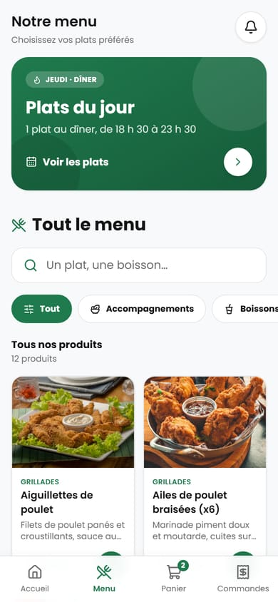 |
| Commande : modes proposés | 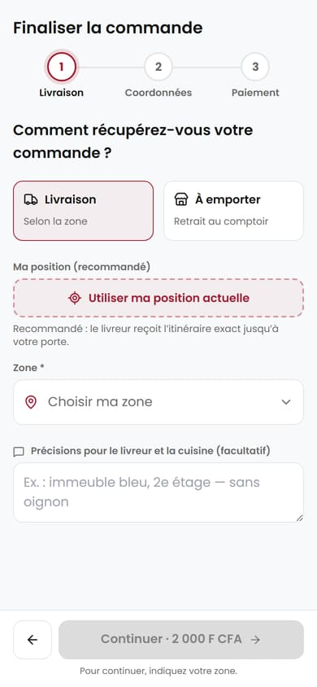 | 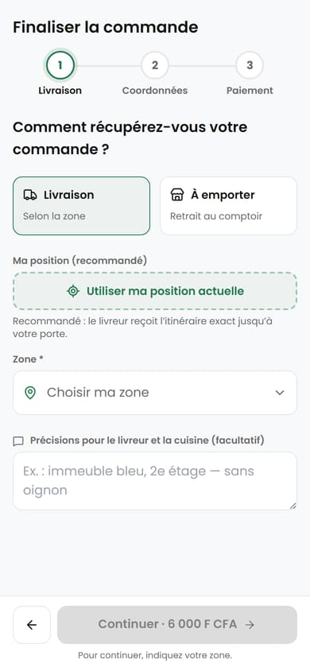 |
| Paiement : seulement Wave et Orange Money (`restaurant.json`) | 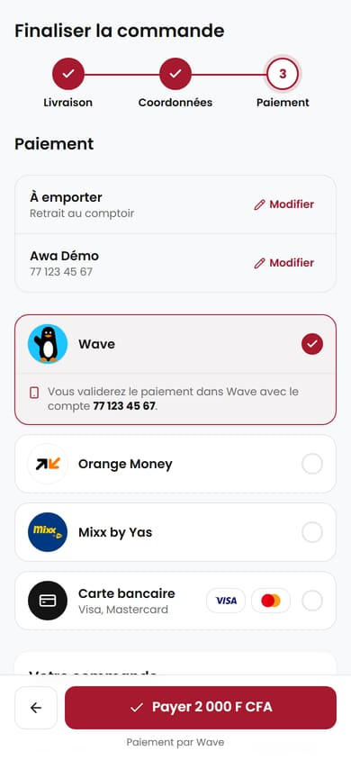 | 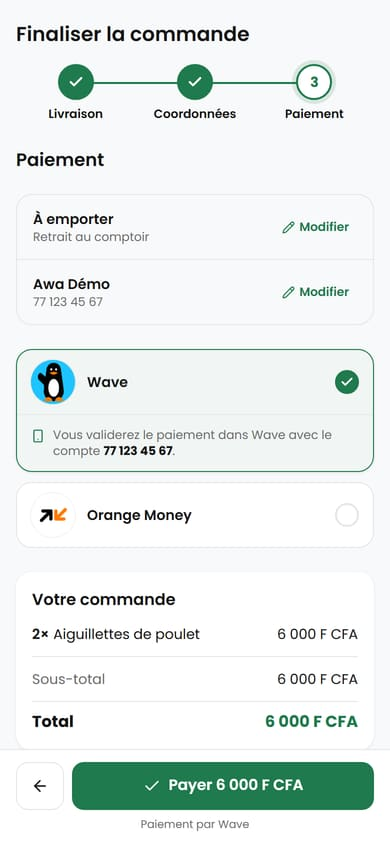 |
| « Besoin d'aide ? » : WhatsApp, réseaux, adresse, horaires d'ouverture | 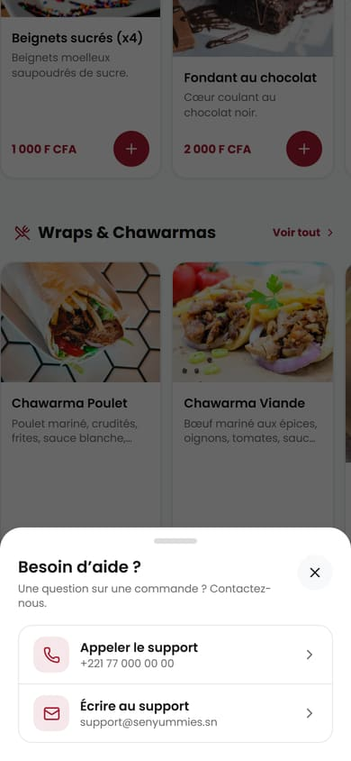 | 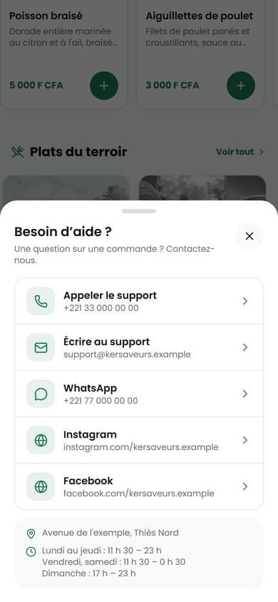 |
| Annonce de lancement importée | 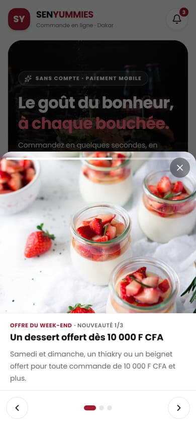 | 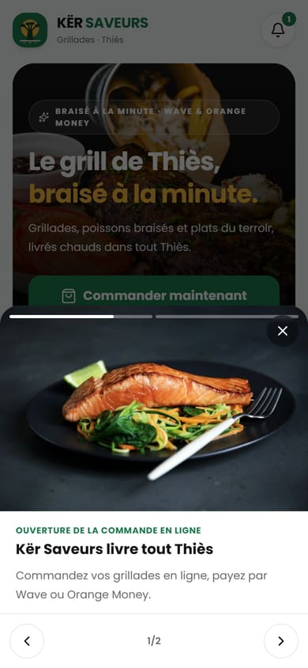 |

## Manager

| | Avant | Après |
|---|---|---|
| Connexion : nom, couleur, photos du restaurant | 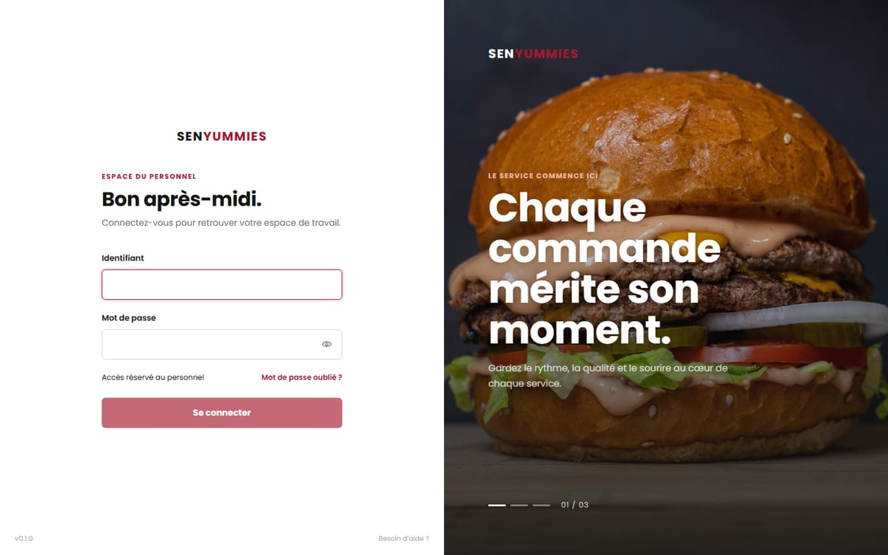 | 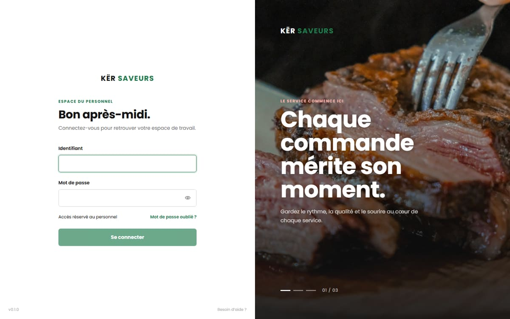 |
| Tableau de bord du Gérant (compte de `comptes-initiaux.txt`, mot de passe changé à la première connexion) | 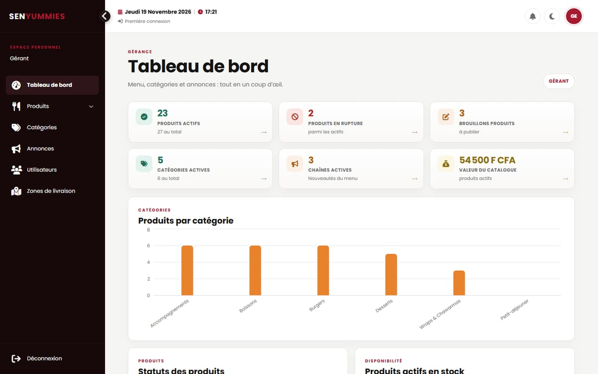 | 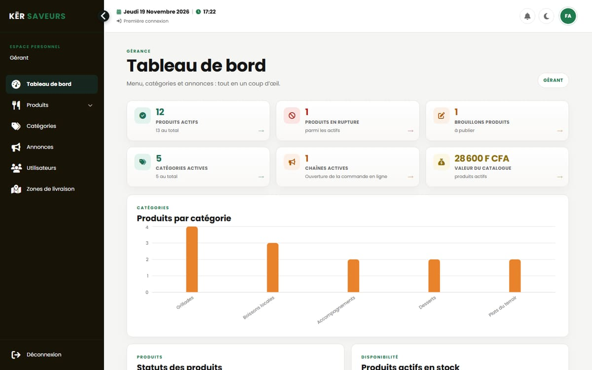 |
| Produits : catalogue et photos importés | 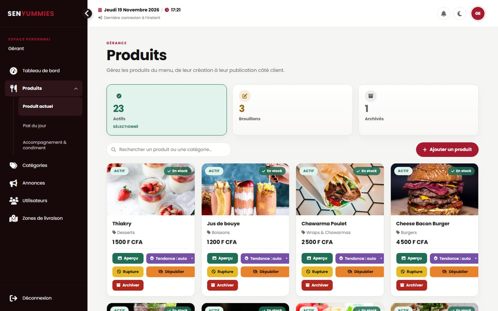 | 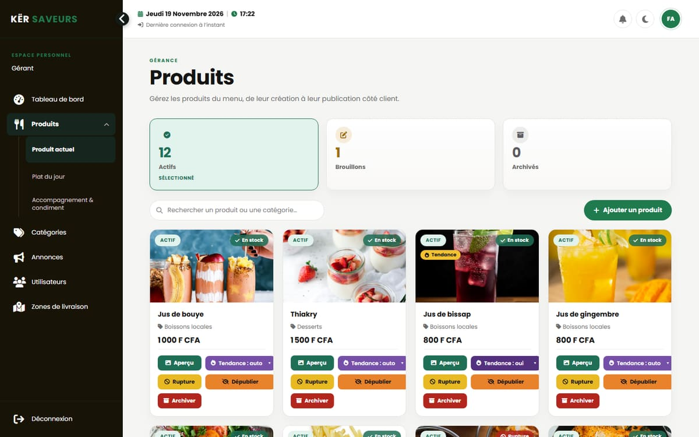 |
| Espace Vendeur | 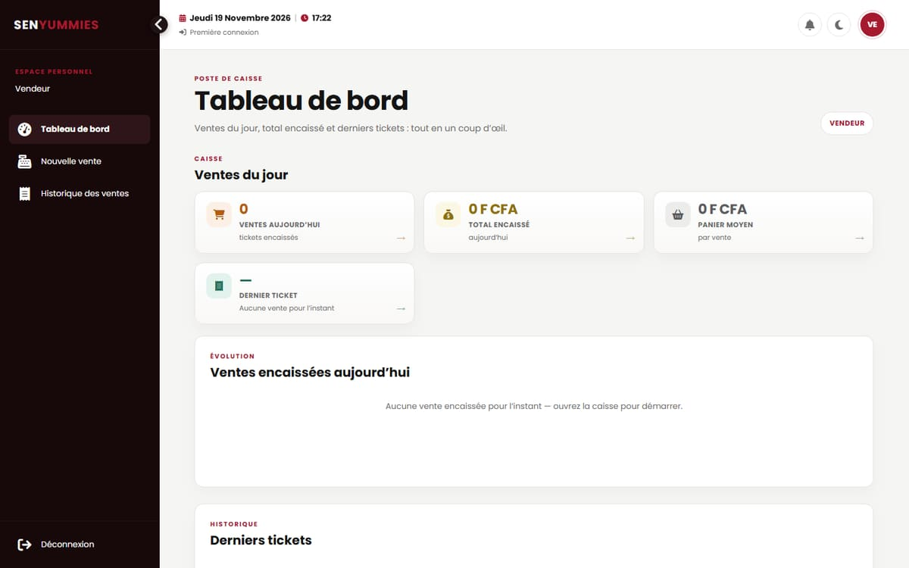 | 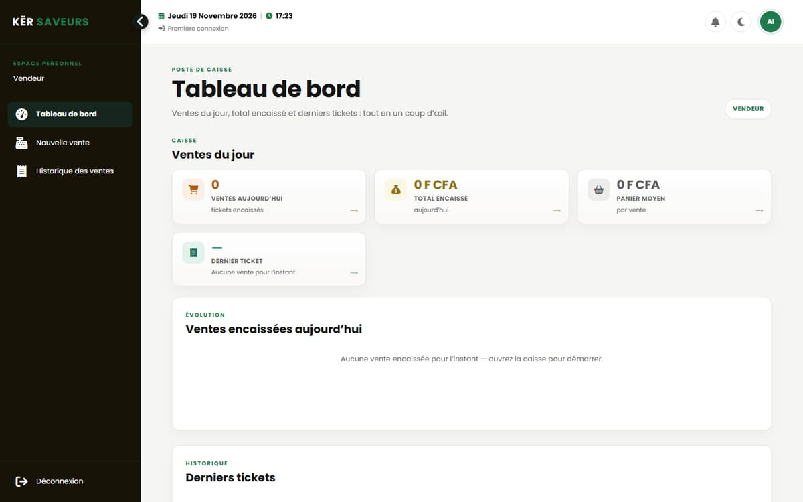 |
